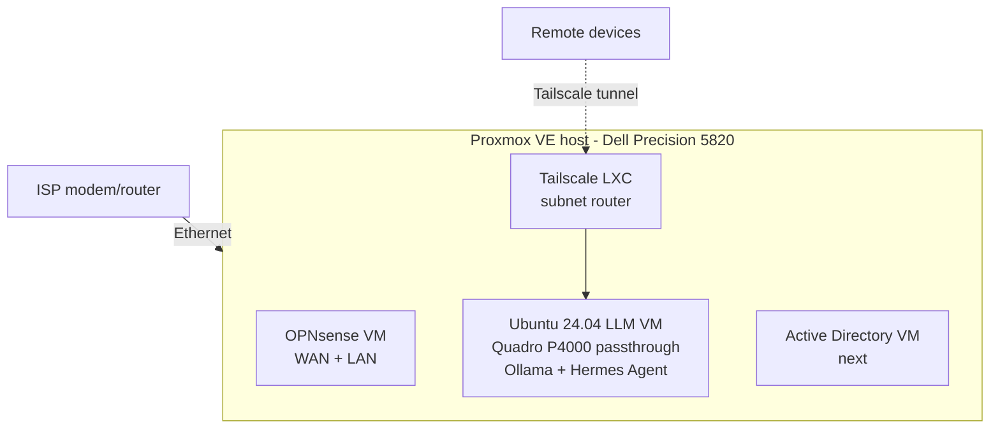
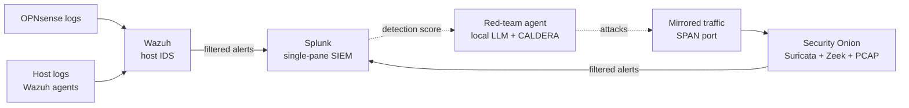

# 🛡️ Cybersecurity Home Lab — Proxmox on Enterprise Hardware

A physical, hands-on home lab built to practice enterprise networking, security operations, and self-hosted infrastructure — the foundation for a career path toward **Cloud Security Architect**.

> **Status:** Active build. Hypervisor, GPU-accelerated local LLM stack, remote access, and the firewall VM are running. Active Directory is next.

---

## 🎯 Goal

Get real, hands-on experience owning an enterprise-style network end to end — the physical hardware *and* the software — instead of only learning it from coursework and certifications (CompTIA Network+, ISC2 CC; AWS Solutions Architect Associate in progress).

Specifically, the lab is meant to build skills in:

- Virtualization and resource planning on a bare-metal hypervisor
- Firewalling, routing, and network segmentation
- Secure remote access without exposing services to the internet
- Security tooling (SIEM, identity, secrets management)
- Infrastructure-as-code and, later, hybrid integration with AWS

---

## 🧰 Hardware

| Component | Details |
|---|---|
| Hypervisor host | Dell Precision 5820 Tower |
| CPU | Intel Xeon W-2123 (4 cores / 8 threads) — drop-in upgrade path to W-2145 / W-2155 |
| RAM | 112 GB DDR4 ECC |
| Storage | Intel DC S3710 800 GB enterprise SSD (boot + VM storage); second S3710 reserved for a future ZFS mirror |
| GPU | NVIDIA Quadro P4000 (passed through to the LLM VM) |
| PSU | 950 W |
| Planned | MikroTik CRS326-24G-2S+RM managed switch, GL.iNet Flint 2 as a downstream Wi-Fi AP, HDD bulk storage tier |

Most of the hardware was sourced from **decommissioned/surplus enterprise equipment** rather than bought new — which repeatedly opened up options (more RAM, a better GPU, a bigger PSU) that a purchase-only plan wouldn't have.

## 💻 Software

| Layer | Tools |
|---|---|
| Hypervisor | Proxmox VE 9.2 |
| Firewall / routing | OPNsense (VM) |
| Remote access | Tailscale (unprivileged LXC container acting as a subnet router) |
| Local AI | Ubuntu 24.04 VM, NVIDIA 580 driver, Ollama, Hermes Agent (Nous Research) |
| Install media | Rufus (DD mode) |

### Planned

| Layer | Tools |
|---|---|
| Network security monitoring | Security Onion (Suricata signatures + Zeek protocol logs + full PCAP) |
| Host detection / SIEM | Wazuh (host IDS, FIM, log analysis) |
| Single-pane correlation | Splunk (filtered alerts from Wazuh + Security Onion) |
| Identity & secrets | Windows Server / Active Directory, HashiCorp Vault |
| Containers & IaC | Docker → Kubernetes, Terraform, Ansible |
| Storage | TrueNAS bulk tier, ZFS mirror (2nd S3710) |
| Offensive / research | MITRE CALDERA + local LLM for an autonomous purple-team loop |

---

## 🗺️ Architecture



### Planned detection & purple-team architecture

The detection stack separates **network** monitoring (Security Onion) from **host** monitoring (Wazuh), then forwards *filtered* alerts into Splunk as a single pane — raw data stays in each tool's native store to respect Splunk's ingest limits. An isolated red-team segment runs an autonomous attack agent built on the local LLM + CALDERA, and the detections it triggers feed back as a coverage score, closing the purple-team loop.



---

## 🪜 Steps Taken

1. **Planned the build order** — networking and firewall fundamentals first, then security tooling, then cloud-native/automation layers.
2. **Upgraded the host** — installed 112 GB ECC RAM and the P4000; worked through a POST failure along the way (see *Problems Solved*).
3. **Installed Proxmox VE 9.2** from a USB drive written with Rufus in DD mode, then set a static management IP and hostname.
4. **Built a GPU-accelerated LLM VM** — enabled IOMMU on the host, passed the Quadro P4000 through to an Ubuntu 24.04 VM, installed the NVIDIA 580 driver, and confirmed Ollama runs `llama3.1:8b` fully on the GPU.
5. **Gave the LLM VM a static IP** inside the VM using netplan, so its address stays fixed without changing settings on the home router.
6. **Installed Hermes Agent** on the LLM VM with a minimal setup and local terminal backend, pointed at local Ollama (`qwen3.5:4b`, 64K context), with its web dashboard enabled.
7. **Set up remote access** with Tailscale in an unprivileged LXC container configured as a subnet router — no ports opened on the home router.
8. **Deployed OPNsense** as a VM with WAN and LAN interfaces as the foundation for network segmentation.

---

## 📄 Configs

> Values in `<ANGLE_BRACKETS>` are placeholders — real addresses, IDs, and hostnames are intentionally left out.

### GPU passthrough (Proxmox host)

**`/etc/default/grub`** — enable IOMMU on the Intel host

```bash
GRUB_CMDLINE_LINUX_DEFAULT="quiet intel_iommu=on iommu=pt"
```

**`/etc/modules`** — load VFIO modules at boot

```text
vfio
vfio_iommu_type1
vfio_pci
```

**`/etc/modprobe.d/blacklist-gpu.conf`** — keep the host from claiming the GPU

```text
blacklist nouveau
blacklist nvidia
```

**`/etc/modprobe.d/vfio.conf`** — bind the P4000 (video + audio functions) to VFIO

```text
options vfio-pci ids=<GPU_VENDOR:DEVICE_ID>,<GPU_AUDIO_VENDOR:DEVICE_ID>
```

**Apply changes**

```bash
update-grub
update-initramfs -u -k all
reboot
```

**`/etc/pve/qemu-server/<VMID>.conf`** — attach the GPU to the VM (q35 machine type)

```text
machine: q35
hostpci0: <PCI_ADDRESS>,pcie=1
```

### Static IP on the LLM VM

**`/etc/netplan/50-cloud-init.yaml`**

```yaml
network:
  version: 2
  ethernets:
    <INTERFACE>:
      dhcp4: false
      addresses:
        - <VM_IP>/24
      routes:
        - to: default
          via: <GATEWAY_IP>
      nameservers:
        addresses: [<DNS_IP>]
```

```bash
sudo netplan apply
```

### Ollama on the LLM VM

**Install and verify GPU use**

```bash
curl -fsSL https://ollama.com/install.sh | sh
ollama pull llama3.1:8b
ollama run llama3.1:8b
ollama ps        # PROCESSOR column should show 100% GPU
nvidia-smi       # confirm VRAM is in use
```

### Tailscale in an unprivileged LXC

**`/etc/pve/lxc/<CTID>.conf`** — pass the TUN device into the container (required for unprivileged containers)

```text
lxc.cgroup2.devices.allow: c 10:200 rwm
lxc.mount.entry: /dev/net/tun dev/net/tun none bind,create=file
```

**`/etc/sysctl.d/99-tailscale.conf`** (inside the container) — allow it to forward traffic as a subnet router

```text
net.ipv4.ip_forward = 1
net.ipv6.conf.all.forwarding = 1
```

**Bring Tailscale up as a subnet router**

```bash
sysctl -p /etc/sysctl.d/99-tailscale.conf
curl -fsSL https://tailscale.com/install.sh | sh
tailscale up --advertise-routes=<LAN_SUBNET>/24
```

Then approve the advertised route in the Tailscale admin console.

---

## 🔧 Problems Solved

| Problem | Cause / Fix |
|---|---|
| **3 beeps at POST** after a RAM upgrade | Mixed-speed DIMMs. Diagnosed by booting with a single stick, then testing sticks one at a time. |
| **No video output** during setup | Not a GPU or driver problem — wrong monitor port/input selected. Lesson: check the physical layer first. |
| **Tailscale wouldn't start in the LXC** | Unprivileged containers don't get `/dev/net/tun` by default. Fixed by adding the cgroup allow + bind-mount lines to the container config. |
| **LLM VM address kept changing (DHCP)** | Set a static IP inside the VM with netplan instead of creating a reservation on the home router. |
| **GTX 1070 wouldn't work in the 5820** | Standardized on the Quadro P4000 for passthrough; the 1070 is parked until the right Dell GPU power cable turns up. |
| **Physical vs. virtual firewall** | Weighed a dedicated box (resilient — a hypervisor crash doesn't kill remote access) against an OPNsense VM. Went with the VM for now, with Tailscale providing an independent remote-access path. |

---

## 📚 What I Learned

- **Resilience drives architecture.** The main argument for a physical firewall isn't performance — it's keeping your remote entry point alive when the hypervisor goes down.
- **pfSense vs. OPNsense** are close cousins (OPNsense is a fork); OPNsense's faster security update cadence made it the better fit for a security-focused lab.
- **Unprivileged containers trade convenience for security** — things like TUN devices have to be granted explicitly, which is the point.
- **GPU passthrough is a full-stack exercise:** firmware/IOMMU, kernel modules, driver blacklisting, VM machine type, and guest drivers all have to line up.
- **Self-hosting an LLM removes per-token cost**, not the cost of hardware, power, or VRAM limits — model size and context length have to fit the card.
- **Troubleshoot bottom-up.** Several "hardware" problems were cables, ports, or mismatched parts.
- **Plans should flex with what's available.** Opportunistic hardware sourcing changed the design more than once — "messy but educational" beat "pretty but shallow."

---

## 🛣️ Roadmap

- [x] Proxmox VE installed and configured
- [x] GPU passthrough + local LLM (Ollama, Hermes Agent)
- [x] Tailscale subnet router for remote access
- [x] OPNsense VM with WAN/LAN
- [ ] Active Directory (Windows Server VM) — **next**
- [ ] VLAN segmentation with the MikroTik managed switch, incl. a SPAN/mirror port for sensor visibility
- [ ] Host detection: Wazuh agents on AD and other hosts (FIM + log analysis)
- [ ] Network security monitoring: Security Onion (Suricata, Zeek, PCAP) on the mirrored interface
- [ ] Splunk as the single-pane SIEM, ingesting filtered alerts from Wazuh + Security Onion
- [ ] HashiCorp Vault for secrets management
- [ ] Docker → Kubernetes, with Terraform + Ansible for provisioning
- [ ] ZFS mirror on the second S3710 SSD
- [ ] TrueNAS bulk storage tier
- [ ] AI purple-team loop: autonomous attack agent (local LLM + CALDERA) vs. the detection stack, scoring coverage
- [ ] Hybrid integration with AWS
